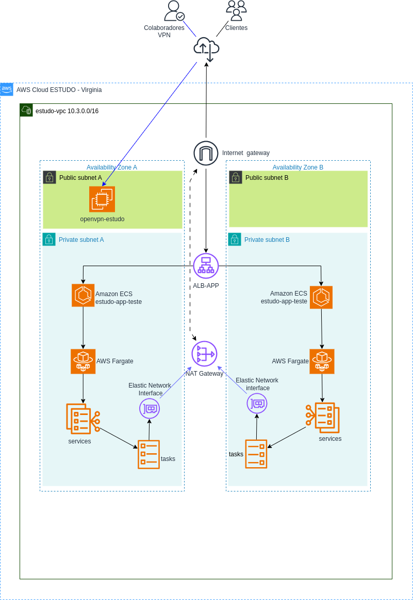

# Desbravando a Automação em Nuvem com AWS Fargate, CloudFormation e GitHub Actions

Nos últimos anos, tenho me especializado em criar soluções de infraestrutura escalável e otimizada em ambientes de nuvem, com foco em automação e eficiência. Este projeto de **Deploy de Aplicação Web com AWS ECS Fargate, CloudFormation e GitHub Actions** sintetiza essa expertise. Ele demonstra de forma clara como aplico meus conhecimentos em nuvem e DevOps para resolver desafios de deploy em ambientes corporativos.

## O que esse projeto demonstra:

- **Automação Completa**: Utilização do **AWS ECS Fargate** para rodar aplicações em containers sem precisar gerenciar servidores, garantindo escalabilidade e redução de custos operacionais.
- **Infraestrutura como Código**: Implementação de toda a infraestrutura com **CloudFormation**, reforçando as melhores práticas de governança, repetibilidade e automação de ambientes.
- **Pipelines CI/CD Modernas**: Configuração de pipelines CI/CD com **GitHub Actions** para automatizar o ciclo completo de build, teste e deploy, proporcionando entregas rápidas e contínuas.

## Por que isso importa para sua empresa?

Em tempos onde agilidade e automação são fatores críticos para o sucesso de projetos de TI, ter um especialista que domina todo o processo — desde a criação de infraestrutura automatizada até a entrega contínua de aplicações — é um diferencial que pode transformar a performance da sua organização.

Ao longo deste projeto, consegui reduzir significativamente o tempo de deploy e otimizar o processo de gerenciamento de containers em produção, tudo isso usando as tecnologias mais avançadas do mercado. Essa experiência me permitiu consolidar minhas habilidades em **AWS**, **DevOps** e **automação de infraestrutura**, habilidades que podem beneficiar diretamente a sua empresa.

## Meu compromisso:

- **Redução de custos** através de infraestruturas eficientes e sob demanda.
- **Aumento da agilidade** nas entregas de software com pipelines CI/CD confiáveis.
- **Segurança e resiliência** com automação de deploy em ambiente de produção, seguindo as melhores práticas do mercado.

---

## Arquitetura



O diagrama editável está em [topologia/AWS-estudo-ecs-cluster.drawio](topologia/AWS-estudo-ecs-cluster.drawio).

## Estrutura do repositório

```
app/                    Aplicação web estática (HTML/CSS/JS) servida pelo Apache no container
cloudformation/         Templates CloudFormation (VPC, Cloud Map, ALB, cluster ECS e serviço)
.github/workflows/      Pipelines do GitHub Actions (deploy e rollback)
topologia/              Diagrama da arquitetura
```

## Pré-requisitos

- Conta AWS com permissões para CloudFormation, VPC, ECS, ECR, ELB, IAM e Cloud Map
- Repositório no Amazon ECR para armazenar a imagem da aplicação
- Os seguintes secrets configurados no GitHub (**Settings → Secrets and variables → Actions**):

| Secret                  | Descrição                                   |
|-------------------------|---------------------------------------------|
| `AWS_ACCESS_KEY_ID`     | Access key do usuário IAM usado no deploy   |
| `AWS_SECRET_ACCESS_KEY` | Secret key do usuário IAM usado no deploy   |
| `AWS_ACCOUNT_ID`        | ID da conta AWS                             |
| `AWS_REGION`            | Região do ECR (ex.: `us-east-1`)            |
| `REPOSITORY_NAME`       | Nome do repositório no ECR                  |

## Deploy

Todos os workflows são disparados manualmente (**Actions → selecionar o workflow → Run workflow**) e devem ser executados nesta ordem, pois cada stack importa recursos dos anteriores:

| Ordem | Workflow                             | Stack criado            |
|-------|--------------------------------------|-------------------------|
| 1     | `1-Deploy VPC Infra`                 | `estudo-vpc`            |
| 2     | `2-Deploy VPC-CLOUD-MAP Infra`       | `estudo-vpc-map`        |
| 3     | `3-Deploy ALB10 infra`               | `estudo-alb10`          |
| 4     | `4-Deploy IMAGE app10 to ECR infra`  | imagem `hit-game-app10` no ECR |
| 5     | `5-Deploy Cluster1 ECS Infra`        | `estudo-ecs-cluster1`   |
| 6     | `6-Deploy Service ECS Infra`         | `estudo-ecs-app-game1`  |

Os workflows de infraestrutura usam `aws cloudformation deploy`, então podem ser executados novamente para aplicar alterações nos templates.

> **Atenção:** antes do passo 6, ajuste o parâmetro `ContainerImage` em
> [cloudformation/environment/FARGATE/service/estudo-ecs-app-game1.json](cloudformation/environment/FARGATE/service/estudo-ecs-app-game1.json),
> substituindo `id-conta-aws` pelo ID da sua conta AWS.

## Rollback

O workflow `Rollback Infra` remove todos os stacks na ordem inversa da criação (serviço → cluster → ALB → Cloud Map → VPC). A imagem no ECR não é removida.

## Executando localmente

```bash
cd app
docker build -t hit-game-app .
docker run --rm -p 8080:80 hit-game-app
```

Acesse http://localhost:8080 e o health check em http://localhost:8080/healthcheck.
